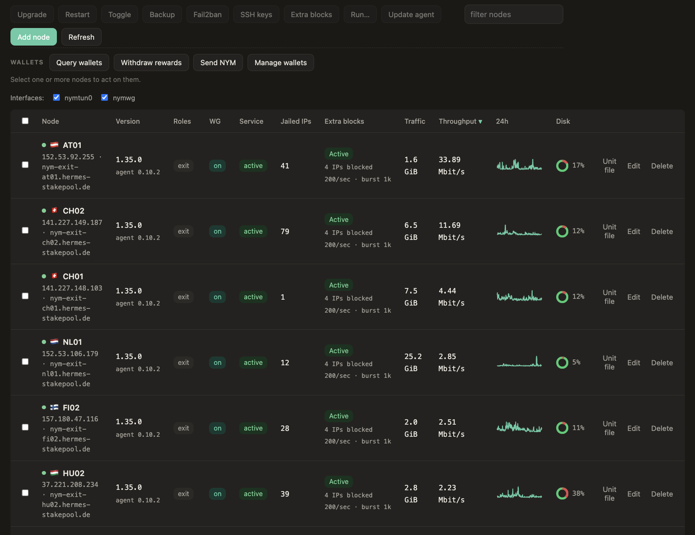
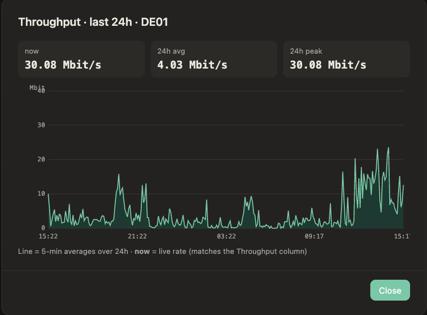
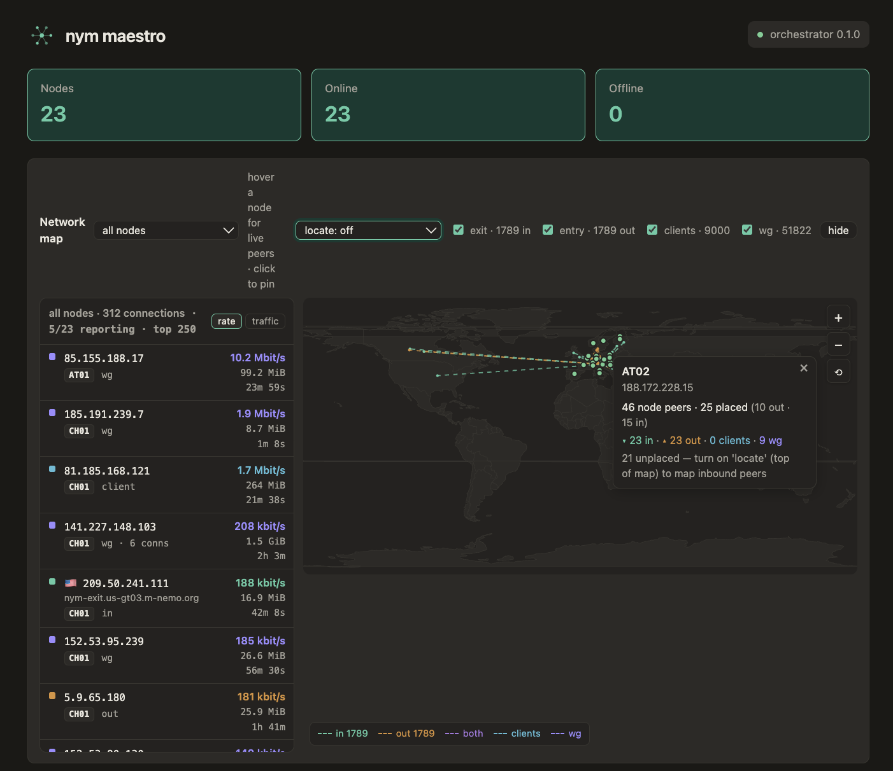
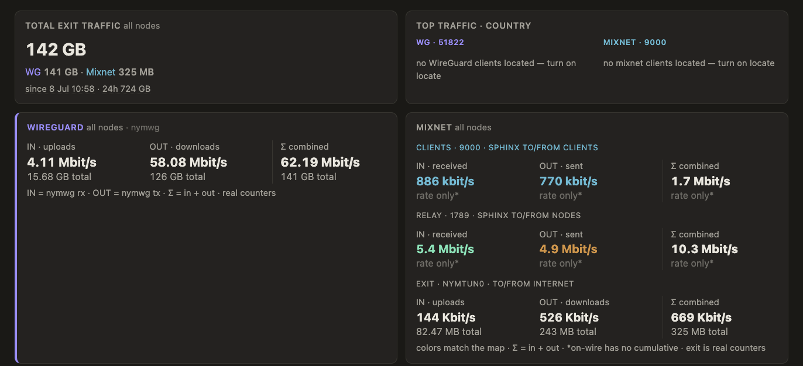

# nym maestro

<p align="center">
  
</p>

A Python mTLS control plane for Nym exit-gateway fleets. Replaces SSH/bash tooling
with a local orchestrator (your workstation — macOS or Fedora Linux) that talks to a
small agent on each node over mutual TLS — fixed command catalogue, no passwords on
the wire, no arbitrary remote root shell.

The orchestrator runs on your machine (or any host — a VPS works too), polls each
node's agent over mTLS, and renders a single dashboard: live throughput, 30-day
history, disk usage, NYX balances and routing score, hoster, OS/distro upgrades,
abuse blocklist + BitTorrent concurrency limit, abuse-report replies, the public
landing page, per-node WireGuard/Mixnet detail, and wallet operations that never
expose keys to a node.

Nodes are Debian/Ubuntu (that's what Nym's `network-tunnel-manager.sh` and the
distro-upgrade feature support). The orchestrator host can be macOS or Fedora.

## Screenshots

> Drop your own PNGs into `docs/screenshots/` (filenames below) and they render here.

| Fleet overview | Throughput history |
|---|---|
|  |  |

| Network map | Per-node detail |
|---|---|
|  |  |

---

## Quick start

> **Windows:** use WSL (Ubuntu). Run `wsl --install` in PowerShell, then follow
> these instructions inside the WSL terminal.

---

### On your workstation (once, ever)

**1. Clone and launch**

```bash
git clone git@github.com:wiiinnie/nym-maestro.git
cd nym-maestro
./run.sh
```

`run.sh` installs Homebrew and Python if missing, creates a virtualenv, installs
pip dependencies, then starts the orchestrator at `http://127.0.0.1:7766`.

On Fedora instead of a Mac, see [Fedora as the orchestrator host](#fedora-as-the-orchestrator-host)
for the prerequisites, then continue here: everything else is identical.

**2. Initialise the CA**

```bash
source .venv/bin/activate
python pki.py init
```

Creates `~/.nym-maestro/pki/` with your CA key and orchestrator cert. Never shared,
never in the repo. Run this once — regenerating the CA invalidates all node certs.

---

### Per-node setup — do this for every new VPS

The flow for each new node is:

```
VPS provider → create node → you get root/password access
       ↓
Create a sudo user on the node (your deployment user)
       ↓
Enable passwordless sudo for that user
       ↓
Open port 8443 (the maestro agent port)
       ↓
Run enroll + deploy from your workstation (uses password SSH — this is the only time)
       ↓
Node appears green in the dashboard
       ↓
Use SSH keys panel in UI to install maestro key + disable password login
```

**3. On the node — create your sudo user (if not already done)**

Log in as root via your VPS provider's console or their provided SSH access:

```bash
adduser <your-user>
usermod -aG sudo <your-user>
```

**4. On the node — enable passwordless sudo**

Required so the deploy script can run `install.sh` as root without prompting:

```bash
echo "<your-user> ALL=(ALL) NOPASSWD: ALL" | sudo tee /etc/sudoers.d/maestro-user
sudo chmod 440 /etc/sudoers.d/maestro-user
```

**5. On the node — open port 8443**

The maestro agent listens on port 8443 (mTLS). Open it before deploying:

```bash
# iptables (Debian/Ubuntu default):
sudo iptables -I INPUT -p tcp --dport 8443 -j ACCEPT
sudo apt install -y iptables-persistent
sudo netfilter-persistent save

# UFW (if active instead):
sudo ufw allow 8443/tcp
```

Verify: `sudo iptables -L INPUT -n | grep 8443`

**6. On your workstation — enroll and deploy**

This uses password-based SSH — it is the only time you need the password:

```bash
source .venv/bin/activate
python pki.py enroll AT01
ssh <your-user>@<node-ip> 'rm -rf /tmp/maestro-deploy && mkdir /tmp/maestro-deploy'
scp dist/AT01/* <your-user>@<node-ip>:/tmp/maestro-deploy/
ssh <your-user>@<node-ip> 'sudo bash -c "cd /tmp/maestro-deploy && bash install.sh"'
```

The agent installs as `nym-maestro-agent.service` (systemd, port 8443).

**7. Add the node in the dashboard**

Open `http://127.0.0.1:7766` → **Add node** → enter name (e.g. `AT01`), IP,
port (default `8443`). Click **Refresh** or wait 30 s — the node goes green.

**8. Switch to key-based SSH (disable password login)**

Once the node is green, open the **SSH keys** panel in the UI:

1. Copy the maestro public key shown (or use your own)
2. Click **Install key** — adds it to the node's `~/.ssh/authorized_keys`
3. Click **Verify login** — confirms key login works before touching password auth
4. Click **Disable password** — locks down SSH to key-only

From this point on, the maestro key (`~/.nym-maestro/ssh/id_maestro`) is the only
way in. Add it to `~/.ssh/config` so plain `ssh <your-user>@<host>` uses it:

```
Host *.your-domain.com
    User <your-user>
    IdentityFile ~/.nym-maestro/ssh/id_maestro
    IdentitiesOnly yes
```

Set `MAESTRO_SSH_USER` so the orchestrator knows which user to connect as:

```bash
export MAESTRO_SSH_USER=<your-user>
```

---

## Fleet rollout

For multiple nodes, use a deploy script with one `deploy()` call per node. Always
test on one node first, then roll to the fleet.

```bash
#!/bin/bash
SSH_KEY=~/.nym-maestro/ssh/id_maestro
USER=<your-user>

deploy() {
  name=$1; ip=$2
  echo "--- $name ($ip) ---"
  python pki.py enroll "$name"
  ssh -i "$SSH_KEY" "$USER"@"$ip" 'rm -rf /tmp/maestro-deploy && mkdir /tmp/maestro-deploy'
  scp -i "$SSH_KEY" dist/"$name"/* "$USER"@"$ip":/tmp/maestro-deploy/
  ssh -i "$SSH_KEY" "$USER"@"$ip" 'sudo bash -c "cd /tmp/maestro-deploy && bash install.sh"'
  echo "--- $name done ---"
}

deploy AT01 1.2.3.4
deploy AT02 1.2.3.5
# ...
```

---

## Fedora as the orchestrator host

The orchestrator is plain Python + OpenSSH + OpenSSL, so a Fedora workstation can
replace the Mac. Only the host changes: the nodes stay on Debian/Ubuntu, and
enrollment, deploy and the dashboard work exactly as described above.

**1. Packages**

```bash
sudo dnf install -y git python3 openssh-clients openssl
python3 --version   # needs >= 3.11; Fedora 40+ ships 3.12+
```

On Linux `run.sh` skips the Homebrew step. It does not install Python, it only checks
that `python3` exists. Fedora's `python3` already includes `venv`, so there is no
separate `python3-venv` package (that's Debian). `openssh-clients` provides
`ssh`/`scp`/`ssh-keygen` for the SSH keys panel. `openssl` decrypts the wallet
`.enc` files.

**2. Clone and launch**: same as on the Mac (`git clone …`, `./run.sh`).

**3. nym-cli (wallet features only)**: download the Linux `nym-cli` binary from
the [Nym releases](https://github.com/nymtech/nym/releases), then either put it on
`PATH` or point `MAESTRO_NYM_CLI` at it:

```bash
install -m 0755 ~/Downloads/nym-cli ~/.local/bin/nym-cli
```

**4. Moving an existing setup from the Mac**

Stop the orchestrator on the Mac first, so the SQLite DB isn't copied mid-write and
two orchestrators don't drive the fleet at once. Then copy the state directories
(over SSH, never through a cloud sync, because `pki/` holds the CA private key):

```bash
# on the Mac
rsync -a ~/.nym-maestro/  <fedora-host>:.nym-maestro/    # pki, maestro.db, ssh key, landing master, settings
rsync -a ~/.nym_wallets/  <fedora-host>:.nym_wallets/    # only if you use the wallet features
rsync -a nym-maestro/backups/ <fedora-host>:nym-maestro/backups/   # optional: node backups
```

```bash
# on Fedora
chmod 700 ~/.nym-maestro ~/.nym-maestro/pki ~/.nym-maestro/ssh
chmod 600 ~/.nym-maestro/pki/*.key ~/.nym-maestro/ssh/id_maestro
```

You don't need to re-enroll anything. Agents trust your CA and the orchestrator
cert's CN, not the host it runs on. Two exceptions: if you restricted port 8443 on
the nodes to the Mac's public IP, allow the new host's IP first. And copy your
`~/.ssh/config` `Host` block (step 8) too.

**5. Firewall / SELinux**: nothing to change. The orchestrator binds to
`127.0.0.1:7766` and only makes outbound connections (8443 to the agents, HTTPS to
the Nyx/nym-api/RIPEstat endpoints), so firewalld's default zone is fine, and the
files under `~` need no SELinux relabelling. If you want the dashboard from another
machine, use an SSH tunnel (`ssh -L 7766:127.0.0.1:7766 <fedora-host>`) rather than
binding to a public address. A non-loopback `--addr` is refused unless
`MAESTRO_API_TOKEN` is set.

**6. Optional: run as a systemd user service** (starts with the session, restarts on
failure; run `./run.sh` once beforehand so `.venv` exists):

```ini
# ~/.config/systemd/user/nym-maestro.service
[Unit]
Description=nym maestro orchestrator

[Service]
WorkingDirectory=%h/nym-maestro
Environment=MAESTRO_SSH_USER=<your-user>
ExecStart=%h/nym-maestro/.venv/bin/python app.py
Restart=on-failure

[Install]
WantedBy=default.target
```

```bash
systemctl --user daemon-reload
systemctl --user enable --now nym-maestro.service
loginctl enable-linger "$USER"     # optional: keep polling while you're logged out
journalctl --user -u nym-maestro -f
```

---

## Components

```
app.py          orchestrator: FastAPI, serves the UI, polls agents (workstation)
store.py        SQLite registry + cached telemetry
pki.py          local CA + per-node enrollment (workstation)
agent/agent.py  node agent: stdlib-only mTLS server (agent/install.sh + unit file)
web/index.html  dashboard (vanilla JS)
schema.sql      applied on first run, additive migrations on restart
blocklist.py    extra-blocks blocklist validation (strict CIDR, prefix limits, list sha)
landing.py      public node-overview block for each gateway's notice page
abuse.py        abuse-report parsing + reply templates
nyx.py          Nyx account balance + nym-api annotation (routing score) parsing
hoster.py       hoster from the node IP's origin AS (RIPEstat)
distro.py       OS inventory, release catalogue, CVE ranking, upgrade planning
wallet.py       encrypted wallet store + nym-cli wrappers
requirements.txt
run.sh          launcher (handles venv + deps)
blocklist.txt   one-time seed for the blocklist; maestro's DB is the source of truth after that
install-nym-extra-blocks.sh   standalone copy of the agent's extra-blocks template (manual installs only)
install-nym-concurrency.sh    standalone copy of the agent's concurrency template (manual installs only)
```

Wallet material stays in `~/.nym_wallets` — never in the DB, never on a node.
Each agent keeps its own 30-day throughput/traffic history in a local SQLite DB
(`/var/lib/nym-maestro-agent/history.db`); the orchestrator backfills from it, so
charts stay gap-free even when the orchestrator is offline or moved to another host.

---

## Configuration

**Orchestrator flags:** `--addr` (default `127.0.0.1:7766`), `--db` (default
`~/.nym-maestro/maestro.db`).

**Environment variables:**

| Variable | Default | Description |
|---|---|---|
| `MAESTRO_PKI` | `~/.nym-maestro/pki` | CA + cert directory |
| `MAESTRO_POLL` | `30` | Agent poll interval in seconds (0 = disable) |
| `MAESTRO_ONWIRE_POLL` | `60` | On-wire sampler interval (0 = disable) |
| `MAESTRO_DB` | `~/.nym-maestro/maestro.db` | SQLite DB (same as `--db`) |
| `MAESTRO_API_TOKEN` | unset | Per-request API token; required to bind to a non-loopback `--addr` |
| `MAESTRO_SSH_USER` | **unset** | SSH login user on each node. Must be set, otherwise the SSH actions don't work |
| `MAESTRO_SSH_DIR` | `~/.nym-maestro/ssh` | Maestro SSH key directory |
| `MAESTRO_SSH_CONCURRENCY` | `6` | Parallel SSH operations |
| `MAESTRO_BACKUPS` | `<repo>/backups` | Where node backups are downloaded to |
| `MAESTRO_LANDING_DIR` | `~/.nym-maestro/landing` | Landing-page master + deploy copy |
| `MAESTRO_HOSTER_POLL` | `3600` | Hoster (origin-AS) lookup interval in seconds (0 = off entirely) |
| `MAESTRO_GEOIP` / `MAESTRO_GEOIP_DB` | `off` / unset | Optional local GeoIP (needs `geoip2` + a MaxMind DB file) |
| `MAESTRO_UPLINK_DEVICE` | auto | Override uplink interface detection |
| `MAESTRO_WALLET_DIR` | `~/.nym_wallets` | Wallet store |
| `MAESTRO_NYM_CLI` | `nym-cli` | nym-cli binary path |
| `MAESTRO_NYX_REST` | polkachu, nodes.guru, nymtech, cosmos.directory | Nyx REST endpoints |
| `MAESTRO_REST_UA` | `nym-maestro/1.0` | User-Agent for reward queries |
| `MAESTRO_MIXNET_CONTRACT` | `n17srj…t0cznr` | Mixnet contract address |
| `MAESTRO_REWARDS_DIR` | `<wallet_dir>/rewards/` | Rewards CSV output directory |
| `MAESTRO_HISTORY_POLL` | `300` | History-sync interval in seconds (0 = disable) |
| `MAESTRO_HISTORY_MAX_PAGES` | `8` | Max `/v1/history` pages pulled per node per sync |
| `MAESTRO_NYX_POLL` | `900` | Nyx balance check interval in seconds (0 = disable) |
| `MAESTRO_NYX_MIN_NYM` | `5` | Warn when a node's Nyx account holds less NYM than this |
| `MAESTRO_MIN_ROUTING_SCORE` | `0.95` | Red "routing N%" warning on a node whose nym-api routing score is below this (0..1) |
| `MAESTRO_NODE_API_PORT` | `8080` | nym-node public HTTP API port (Nyx address lookup) |
| `MAESTRO_NYM_ANNOTATION_URL` | `validator.nymtech.net/api/v2/nym-nodes/annotation/` | nym-api per-node annotation base (network verdict) |

**Agent-side (set on each node's `nym-maestro-agent.service` if needed):**

| Variable | Default | Description |
|---|---|---|
| `MAESTRO_ORCH_CN` | `nym-maestro-orchestrator` | Required CN on the client cert (see Trust model) |
| `MAESTRO_AGENT_HISTORY_DIR` | `/var/lib/nym-maestro-agent` | Agent history DB directory |
| `MAESTRO_HISTORY_RETENTION_S` | `2592000` | History retention window (30 days) |
| `MAESTRO_HISTORY_BUCKET_S` | `60` | History bucket size (1-minute buckets) |
| `MAESTRO_WEBROOT` | `/var/www` | Parent of `<hostname>/index.html` for the landing page |

The extra-blocks scan rate-limit (`nym_scan_v2`, 200/sec, burst 1000) is fixed in the
agent's template. The old `NYM_EB_RATE`/`NYM_EB_BURST` variables no longer exist.
The concurrency limit lives in `/var/lib/nym-concurrency/limit` on each node and is
set from the UI (10..10000, default 50).

---

## Trust model

A local CA on your workstation signs one orchestrator client cert and one server cert per
node. The agent refuses any connection not signed by your CA; the orchestrator
refuses any server not signed by your CA. Nothing unsigned completes the TLS
handshake. The CA private key never leaves your workstation.

Because every node's server cert is signed by the same CA, a CA-signed check alone
would let one compromised node impersonate the orchestrator to another. The agent
therefore also pins the client cert's Common Name to `nym-maestro-orchestrator`
(override with `MAESTRO_ORCH_CN`) — so a node's own cert can never drive root
actions on another node.

nym-node binary upgrades are optionally sha256-verified before the downloaded
binary is made executable or run.

### Wallets

Wallet operations run on the orchestrator (your workstation), never on the agents.
Mnemonics live only in `~/.nym_wallets` (AES-256 `.enc`, same format as the old
`nym_node_manager.sh`) and are decrypted in-memory for the duration of one request.
`nym-cli` signs locally and broadcasts to Nyx — the spendable key never touches an
internet-facing node.

The wallet password is passed via environment variable, not argv, so it's invisible
in `ps`. Nothing logs a mnemonic or password. Redeem and send require explicit
`confirm=true`.

---

## Dashboard

### Network map

One dot per node, placed by country (AT01 → Austria; same-country nodes fan out on
a ring). Hover a node to draw its live 1789 peer web:

- **Green** = peer dialled us (upstream)
- **Orange** = we dialled peer (downstream)
- **Purple** = both directions

Clients (9000) and verloc (1790) are excluded — this is the node graph only. Peer
IPs are geolocated against the Nym topology API (cached). Roles flip per epoch so
the web is a live snapshot.

### Traffic cards (top row)

**Total exit traffic** — `nymtun0` + `nymwg` cumulative since last **nym-node
restart**, WG / Mixnet split, plus real 24h exit volume.

**Top traffic · country** — WG (51822) and Mixnet (9000) side by side. Ranks by
on-wire client bytes (sphinx-padded for mixnet, so it exceeds the exit total —
different measurement planes, not a bug).

### Per-node detail cards (bottom row)

Select a node in the map dropdown. Each section shows **IN · OUT · Σ**.
IN = uploads (user → internet), OUT = downloads (internet → user). OUT is always
the big number.

**WireGuard** (violet) — `nymwg` rx/tx. Real kernel counters, rate + running total.
No double-counting: a 1 GB download = ~1 GB OUT, not 2 GB.

**Mixnet** — three colour-matched sections:
- **clients · 9000** (cyan) — sphinx to/from connected clients. Rate only.
- **relay · 1789** (green IN / orange OUT) — sphinx to/from other nodes. Rate only.
  Padded + cover-inflated; treat as "how hard am I shuffling," not user data.
- **exit · nymtun0** (neutral) — real decrypted payload to/from the internet. Rate
  + running total. Usually tiny vs on-wire — expected and correct.

### Fleet table columns

Beyond version, roles, WG, and service state, each row shows:

- **Extra blocks** — NYM-EXIT abuse blocklist status: `Active`/`Inactive`, the count
  of blocklist entries present as `nym_block`-marked REJECTs (not the node-wide exit
  policy, which adds hundreds), their hit counter, and the live per-source scan
  rate-limit (`nym_scan_v2`, maestro's own rule — Nym's NTM ships none). Flags
  `list outdated` when a node runs a different list than the one saved in maestro,
  and `N unmarked` while pre-0.12.9 rules await migration. The blocklist itself is
  edited in the modal (maestro is the source of truth, no GitHub fetch) and rolled
  out per selection; a rollout reconciles, so removed entries leave the nodes too.
  The list is no longer a `blocklist.txt` fetched from GitHub. It is stored in
  maestro's DB (`app_config`), seeded once from the repo's `blocklist.txt`, and
  edited in the UI. Every line must be a strict CIDR (host bits set = error); prefixes
  broader than /16 (v4) or /32 (v6) are rejected. Nodes need agent ≥ 0.12.9.
- **Concurrency**: the anti-BitTorrent cap on *simultaneous* connections per client
  to high ports (12000–65535, TCP+UDP) via `connlimit` in `mangle NYM-CONCURRENCY`,
  hooked only for `nymwg`/`nymtun0`. Shows the live limit (default 50) and drop counter.
  Install/limit/restart only on exit gateways.
- **Hoster**: derived from the origin AS of the node IP (RIPEstat), not from the
  hostname. Links to bgp.tools, with ASN/holder/prefix in the tooltip.
- **OS**: distro + version from `/etc/os-release` (agent ≥ 0.12.7; older agents
  fall back to the last distro scan).
- **Routing score** — nym-api's `routing_score` from the per-node annotation (fetched
  together with the NYX check, so same interval and **Refresh**). Below
  `MAESTRO_MIN_ROUTING_SCORE` (default 0.95) the node's name gets a red `routing N%`
  pill (performance/config score in the tooltip) and the fleet summary counts it
  under **Routing low**. An unknown score is no warning.
- **NYX** — balance of the node's own Nyx account, the one that pays for ticket
  redemptions. The address comes from the node's public HTTP API
  (`http://<ip>:8080/api/v2/auxiliary-details`), the balance from the Nyx LCDs
  (`MAESTRO_NYX_REST`, same list as the wallet feature). Refreshed every
  `MAESTRO_NYX_POLL` seconds (default 15 min) and on **Refresh**. Below
  `MAESTRO_NYX_MIN_NYM` (default 5) the cell turns red with a "below N NYM" pill and
  the fleet summary counts it under **NYX low** — top the account up before the node
  stops redeeming tickets. The amount links to the account on cosmoscan. If a check
  fails the last known balance stays visible, marked *stale* (hover for the error).
  The same cell carries the **network's own verdict** from nym-api's per-node
  annotation (looked up by the numeric nym-node id from the bonded list): a red
  `network: insufficient` pill when `has_sufficient_tokens` is false (the node is
  losing config score, nym-api's bar is 1 NYM), and a `feegrant` note when another
  account pays the node's fees (then a low own balance is not warned about). When
  the live LCD read fails, nym-api's cached balance is shown dimmed as a fallback.
- **24h** — throughput sparkline over the last 24 hours (click to expand).
- **Disk** — green/red pie of the **root partition** usage (`os.statvfs("/")`, so it
  works regardless of the device name, which differs per VPS). Colour escalates:
  muted < 70%, amber 70–90%, red > 90%.

The Version column also stacks the maestro **agent version** beneath the nym-node
version (amber if the agent is older than the orchestrator).

### Other tools

- **Abuse replies** (`#abuse` tab): paste a report and maestro extracts the case ID +
  IP, matches the complainant and the node, and drafts a reply. A repeat complainant
  gets its last saved reply word for word with the new case ID. Otherwise the reply
  comes from an editable template (mere conduit, no logs, no client data, exit policy,
  rate limiting). Nothing is sent: you copy and paste the reply, and **Save**
  keeps it for reuse.
- **Landing page**: generates the node-overview block (name, IP, hostname, country
  only) into each gateway's public notice page `/var/www/<hostname>/index.html`,
  between `<!-- NODES:AUTO START/END -->`. **Rebuild** and **Deploy** are separate
  steps. Deploy is sha256-verified, keeps an `index.html.bak-<version>` backup, swaps
  atomically, and can be reverted.
- **Distro / OS upgrade**: dry run (pending packages, next release, top CVEs from
  Ubuntu USNs), fleet recommendations, then a rolling upgrade (default 1 node at a
  time, optional pre-upgrade backup) with pull-based reboot verification. Ubuntu
  stays on the LTS train, and Debian moves N→N+1.

### Throughput history

Each agent buckets its own throughput and traffic into 1-minute samples in a local
SQLite DB and keeps a rolling 30-day window. The orchestrator's history-sync loop
pulls whatever it's missing (cursor-paginated, idempotent), so the 24h chart and
the expanded history view stay **gap-free across orchestrator downtime** — close
your laptop overnight and the line is continuous the next morning. It also means the
orchestrator can run from any host (e.g. a VPS) and catch up on restart.

### Two clocks, one explanation

- **Exit traffic** resets on **nym-node restart** (`nymtun0`/`nymwg` are created by
  nym-node; a restart makes fresh zeroed interfaces).

---

## Agent versions

| Version | What it adds |
|---|---|
| 0.9.6 | Uplink detection (`_default_iface()`), reports `uplink_device` + `boot_since` |
| 0.9.7 | Directional interface counters (`traffic_dir`, `throughput_dir`), WG + Mixnet-exit IN/OUT |
| 0.9.8 | Split on-wire into `onwire_clients` (9000) + `onwire_peers` (1789), each `{rx_bps,tx_bps}` |
| 0.9.9 | Extra-blocks live rate/burst + blocklist-aware blocked count in fleet status |
| 0.9.10 | Client-cert CN pinning (privesc fix); sha256-verify nym-node binary on upgrade |
| 0.10.0 | Agent-side 30-day history buffering, `GET /v1/history` with cursor pagination |
| 0.10.1 | Root-partition disk usage (`read_disk`) in status |
| 0.10.2 | Status path reads the blocklist from the local cache only — never the network |
| 0.10.3 | nym-node upgrade can re-run `network_tunnel_manager` without a binary swap (NTM-only) |
| 0.11.0 | Landing page: `landing_status` / `landing_deploy` / `landing_revert` (sha256-verified, atomic, symlink-safe) |
| 0.12.0 | Distro upgrade: `os_info`, `distro_upgrade`, `distro_upgrade_status` (detached systemd runner) |
| 0.12.1 | Upgrade resilience: needrestart pin, orphan recovery, `ensure_essentials` |
| 0.12.2 | State-file freshness as liveness signal; a stuck mid-flight state self-heals via scan |
| 0.12.3 | `reset-failed` before service restart |
| 0.12.4 | Adaptive restart/stop wait for slow nym-node teardown (~15k WG peers) |
| 0.12.5 | Fan-out limiter status (`fanout_*`) in the extra-blocks state |
| 0.12.6 | Fan-out limiter in the built-in extra-blocks template |
| 0.12.7 | `os` (from `/etc/os-release`) in the status poll for the OS column |
| 0.12.8 | Nym concurrency: per-client `connlimit` on high ports (`concurrency_*` actions) |
| 0.12.9 | Maestro-managed blocklist: `entries` instead of `list_url`, `nym_block` marker, reconcile + migration |

Current agent: **0.12.9**. Older agents answer unknown actions with HTTP 400
`unknown action: …`; the UI skips agents < 0.12.9 for blocklist rollouts.

---

## Deploy checklist

1. `./run.sh` restart + browser hard-refresh (runs additive DB migration).
2. Push agent via **"Update agent"** in the UI — **one node first**, verify green,
   then roll to the fleet.
3. Sanity check: WireGuard OUT should be the big number; a known download should
   show ~its real size on OUT (not 2×); on-wire mixnet ≫ exit.

Graceful degradation before agent is updated:
- WireGuard + Mixnet-exit totals need **≥ 0.9.7**
- clients/relay on-wire split needs **≥ 0.9.8** (shows `—` until then)

---

## Tests

The suites are plain scripts (not pytest). Each prints `N passed, M failed` and exits
1 on failure. 984 passing, plus 1 known pre-existing failure in `test_wallet.py`
(`redeem passes --mnemonic`).

```bash
source .venv/bin/activate
python smoke_test.py          # 26  — registry API
python test_agent_mtls.py     # 43  — CA, agent, mTLS, orchestrator poll
python test_actions.py        # 86  — flag edits, ssh harden, fail2ban, backups
python test_migration.py      # 7   — surrogate-uid schema migration
python test_peers.py          # 65  — 1789 peer-scan, topology harvest, geolocation
python test_extra_blocks.py   # 87  — NYM-EXIT scan limit, fan-out, blocklist reconcile (v4 + v6)
python test_blocklist.py      # 12  — blocklist validation, agent parity
python test_concurrency.py    # 75  — connlimit chain, limit validation, script parity
python test_landing.py        # 193 — landing generator, splice, escaping, deploy safety
python test_abuse.py          # 64  — report parsing, templates, reply reuse
python test_nyx.py            # 94  — Nyx balance, nym-api annotation, routing score
python test_hoster.py         # 36  — origin-AS lookup, hoster names
python test_distro.py         # 94  — release catalogue, CVE ranking, upgrade planning
python test_delegation.py     # 40  — delegation drafts
python test_wallet.py         # 62 (+1 known failure) — wallet store, nym-cli wrappers
```

---

## API reference

### Orchestrator (`localhost:7766`)

```
GET    /api/health
GET    /api/nodes                 registry joined with cached status
POST   /api/nodes
GET    /api/nodes/{id}
PATCH  /api/nodes/{id}            partial; node_id is immutable
DELETE /api/nodes/{id}
POST   /api/refresh               poll all enabled agents over mTLS
POST   /api/peers                 live 1789 peers for one node, geolocated
GET    /api/traffic/window        exit volume/avg, cumulative-counter deltas
GET    /api/onwire/avg            on-wire avg from the peers sampler
GET    /api/throughput            sparkline/24h chart (backfilled from agent history)
GET    /api/throughput/avg        24h average (labels real span if < 24h, e.g. Ø6h)
POST   /api/history/sync          force an immediate history backfill from all agents
GET    /api/blocklist                      the saved blocklist (text + parsed summary + sha)
PUT    /api/blocklist                      save it (400 + per-line errors if any line is invalid)
POST   /api/blocklist/check                validate without saving
POST   /api/extra-blocks/status            per-node state (counts, hits, list_sha, stale/legacy)
POST   /api/extra-blocks/install           roll the saved list out (reconcile) to the given nodes
POST   /api/extra-blocks/upgrade|verify|remove
POST   /api/extra-blocks/restart-service   restart the nym-extra-blocks oneshot
POST   /api/concurrency/status|install|limit|restart|verify|remove
POST   /api/nyx/refresh                    re-check Nyx balances + nym-api annotation
POST   /api/hoster/refresh                 force hoster lookups for all nodes
POST   /api/exec | /api/backup | /api/agent/update
POST   /api/fail2ban/status|setup|unban
GET    /api/ssh/key   POST /api/ssh/install|verify|status|harden
GET    /api/landing/status|preview   POST /api/landing/master|master/fetch|rebuild|nodes|deploy|revert
POST   /api/distro/scan|check|upgrade|cancel   GET /api/distro/progress
GET|PUT /api/abuse/template   POST /api/abuse/draft
GET|POST /api/abuse/cases     GET|DELETE /api/abuse/cases/{id}
GET    /api/settings   POST /api/settings/geoip
GET    /favicon.ico | /favicon.svg | /apple-touch-icon.png
```

### Wallets (orchestrator-local; keys never leave the orchestrator host)

```
GET    /api/wallet/list                    names + whether nym-cli is present
POST   /api/wallet/query                   balances + pending operator rewards (read-only)
POST   /api/wallet/redeem                  withdraw rewards into balance (confirm=true)
POST   /api/wallet/send                    send NYM (confirm=true)
POST   /api/wallet/add                     import a mnemonic (encrypted at rest)
POST   /api/wallet/export                  reveal a mnemonic (localhost UI only)
POST   /api/wallet/delete                  remove a wallet .enc (confirm=true)
GET    /api/wallet/rewards-files           list per-withdrawal CSVs + totals
GET    /api/wallet/rewards-file/{name}     download one dated withdrawal CSV
```

### Agent (mTLS, port 8443, on each node)

```
GET    /v1/health
GET    /v1/status     version, roles, wireguard, service, bans,
                      traffic_dir, throughput_dir, uplink_device,
                      boot_since, nym_node_since, disk, extra_blocks,
                      concurrency, os
GET    /v1/history    ?since=&until=&kind=tput|traffic — rolling 30-day
                      history, cursor-paginated (for orchestrator backfill)
(exec) peers          established 1789 conns + onwire_clients + onwire_peers
(exec) restart, toggle, upgrade, update_agent, service_file, get_execstart,
       backup, backup_cleanup, fail2ban_*, ssh_*, extra_blocks_*,
       concurrency_*, landing_*, os_info, distro_upgrade, distro_upgrade_status
```

---

## Roadmap

1. Local foundation — registry + UI ✓
2. Agent + live status over mTLS ✓
3. Safe write actions: restart → upgrade → toggle ✓
4. fail2ban + harden-ssh (native, no expect) ✓
5. File ops: landing-page deploy (replace-html), then backup ✓
6. `run_allowlisted` — gated + audited, last
